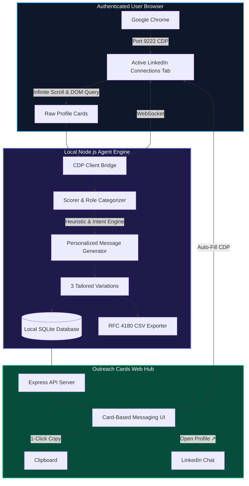

# ⚡ LinkedIn Outreach Agent

> **AI-Powered Connection Intelligence, High-Value Shortlisting & 1-Click Personalized Messaging Hub.**

[](LICENSE)
[](https://nodejs.org/)
[](https://chromedevtools.github.io/devtools-protocol/)
[](https://github.com/WiseLibs/better-sqlite3)
[](CONTRIBUTING.md)

---

## 🎯 What is LinkedIn Outreach Agent?

Most professionals have hundreds of 1st-degree connections on LinkedIn, but rarely know who is an active founder, which recruiter is currently hiring, or how to reach out without sounding like an automated spam bot.

**LinkedIn Outreach Agent** runs locally on your machine, connects to your active Chrome browser via the **Chrome DevTools Protocol (CDP)**, analyzes your visible connections, scores their relevance against your personal profile and career goals, and generates **3 distinct, authentic outreach drafts** for every person in a responsive cards interface.

---

## 🏛️ System Architecture



---

## ✨ Key Features

* **⚡ Zero-Credential Browser Bridge:**
  Connects to your existing, authenticated Google Chrome window via Chrome DevTools Protocol (`127.0.0.1:9222`). No sharing of passwords, cookies, or third-party credentials.
* **🎯 Automatic Role Categorization:**
  Instantly identifies and segments your network into:
  * 👔 **Founders & CEOs** (Early-stage builders, executives, startup partners)
  * 🎯 **Recruiters & Talent Leaders** (Pinterest, The LEGO Group, Cadillac F1, UN, etc.)
  * 🧠 **CTOs & Technical Visionaries** (Engineering leaders & architects)
  * 🤖 **AI/ML Leads & Researchers** (Agentic AI, LLM, Computer Vision, RAG specialists)
  * 💼 **CFOs, COOs & Executives** (Operational and revenue leadership)
  * 🔥 **Actively Hiring** (Direct detection of *"we are hiring!"*, talent partners, and hiring managers)
* **✍️ 3 Personalized Message Variations Per Person:**
  * **⚡ Concise (< 75 words):** Low friction, clear intent, respectful of executive time.
  * **💡 Value-First & Project Insight:** Connects your hands-on background and project proof with their domain.
  * **🤝 Conversational & Narrative:** Warm, authentic student-founder narrative focused on long-term relationships.
* **📋 1-Click Action Hub:**
  * **Copy Message:** Instant clipboard copy with visual feedback.
  * **Open in LinkedIn:** Opens candidate profiles in a single click.
  * **Auto-Fill via CDP:** Types the draft directly into your active Chrome chat box.
  * **Messaged Tracking:** Mark connections as contacted so you never double-reach.
* **📊 Comprehensive CSV Export:**
  Generates an RFC 4180-compliant spreadsheet ready for Google Sheets or Excel.
* **🔒 100% Local & Private:**
  All profile data stays on your local machine inside an SQLite database (`outreach.db`).

---

## 🚀 Quick Start Guide

### 1. Clone & Install

```bash
git clone https://github.com/iamnih4l/linkdin-outreach.git
cd linkdin-outreach
npm install
```

### 2. Configure Your Profile

Copy the template and set your name, role, and goals so generated messages authentically reflect who you are:

```bash
cp .env.example .env
```

Open `.env` in any text editor and adjust:
```env
USER_NAME="Your Name"
USER_ROLE="AI Engineering Student & Startup Co-Founder"
USER_BACKGROUND="Hands-on builder focusing on AI agents and scalable systems."
```

### 3. Launch Chrome with Remote Debugging

Close all active Chrome instances, then launch Chrome with debugging enabled on port `9222`:

* **Windows (PowerShell):**
  ```powershell
  & "C:\Program Files\Google\Chrome\Application\chrome.exe" --remote-debugging-port=9222
  ```
  *(Or if installed in 32-bit: `& "C:\Program Files (x86)\Google\Chrome\Application\chrome.exe" --remote-debugging-port=9222`)*

* **macOS (Terminal):**
  ```bash
  /Applications/Google\ Chrome.app/Contents/MacOS/Google\ Chrome --remote-debugging-port=9222
  ```

* **Linux:**
  ```bash
  google-chrome --remote-debugging-port=9222
  ```

In the opened Chrome window, navigate to your LinkedIn connections page:
**`https://www.linkedin.com/mynetwork/invite-connect/connections/`**

### 4. Start the Application

```bash
npm run dev
```

Open your browser to:
**`http://localhost:3000`**

### 5. Sync Your Connections

You can sync your connections in two ways:
1. **Via the Web UI:** Click **`🔄 Sync from Chrome`** in the top navigation bar.
2. **Via the Terminal:** Run `npm run sync`.

The agent will scroll your connections tab, score relevance, generate tailored outreach drafts, and display them in interactive cards.

---

## ⚙️ Configuration Reference

| Environment Variable | Default | Description |
| :--- | :--- | :--- |
| `PORT` | `3000` | Port for the local web dashboard. |
| `CHROME_DEBUG_PORT` | `9222` | Chrome DevTools Protocol port. |
| `USER_NAME` | `Nihal` | Your first name for message greetings and sign-offs. |
| `USER_ROLE` | *AI Builder* | Your title/role used in candidate value propositions. |
| `USER_BACKGROUND` | *Hands-on builder* | Brief 1-sentence summary of your technical focus. |
| `OPENAI_API_KEY` | *(empty)* | Optional. Uses local heuristic engine if not provided. |
| `OPENAI_MODEL` | `gpt-4o-mini` | LLM model to use if OpenAI key is supplied. |

---

## 🛡️ Privacy & Compliance Notice

* **Human-in-the-Loop Constraint:** This software is designed exclusively as a personal research and drafting assistant. It **does not** automatically send unsolicited bulk messages. Every message must be reviewed and sent manually by the user.
* **Respect LinkedIn Terms of Service:** Always review your messages to ensure they are respectful, personalized, and genuine. Do not spam your network.

---

## 🤝 Contributing

Contributions are welcome! Please read [CONTRIBUTING.md](CONTRIBUTING.md) for details on our code of conduct and development workflow.

1. Fork the repo.
2. Create your feature branch (`git checkout -b feature/amazing-feature`).
3. Commit your changes (`git commit -m 'feat: add amazing feature'`).
4. Push to the branch (`git push origin feature/amazing-feature`).
5. Open a Pull Request.

---

## 📄 License

Distributed under the MIT License. See [LICENSE](LICENSE) for more information.
